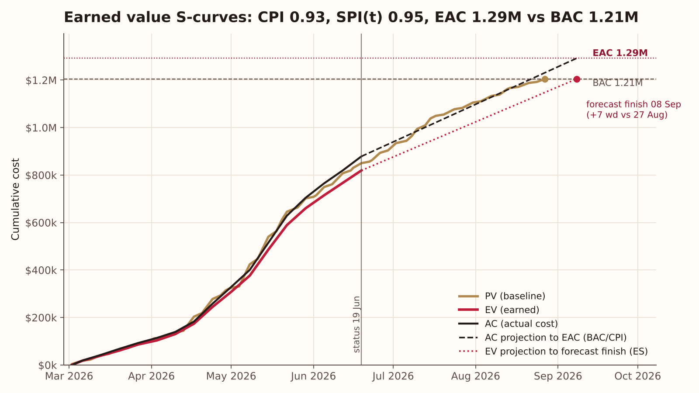
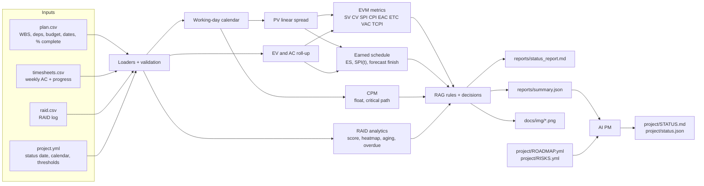
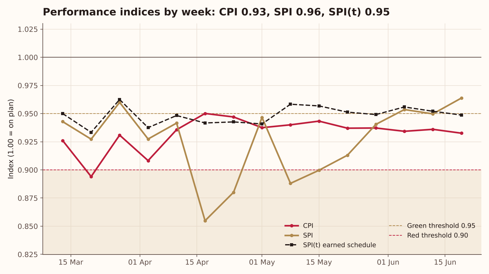
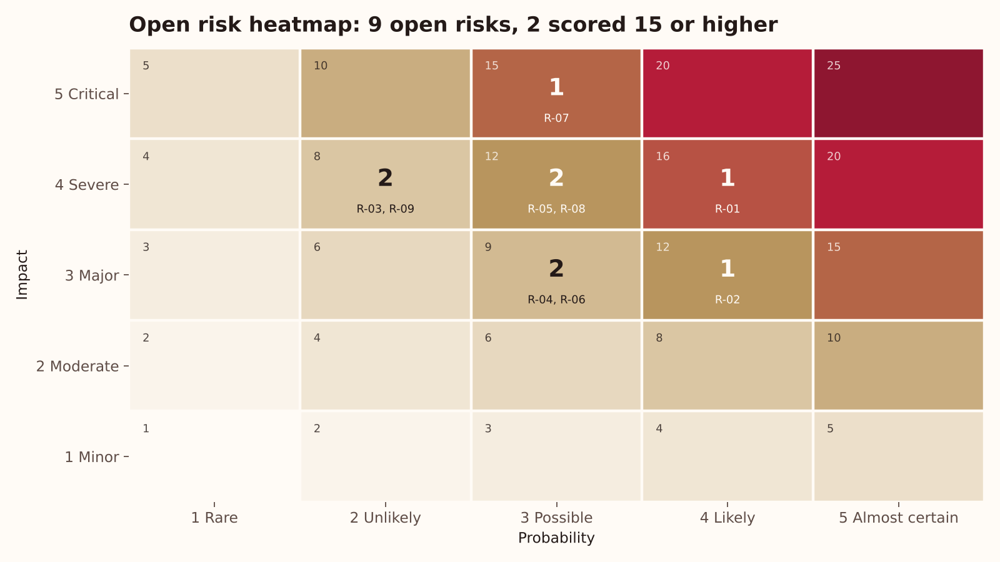
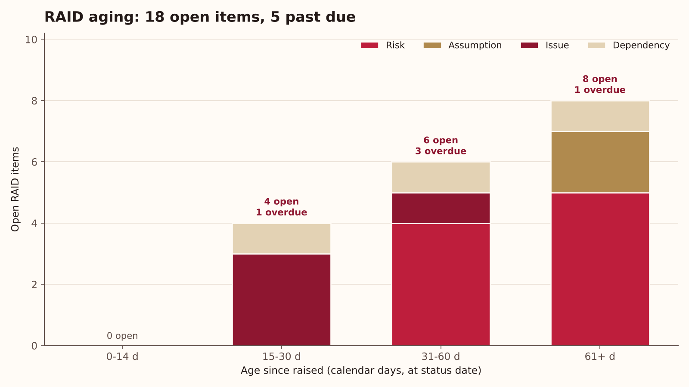
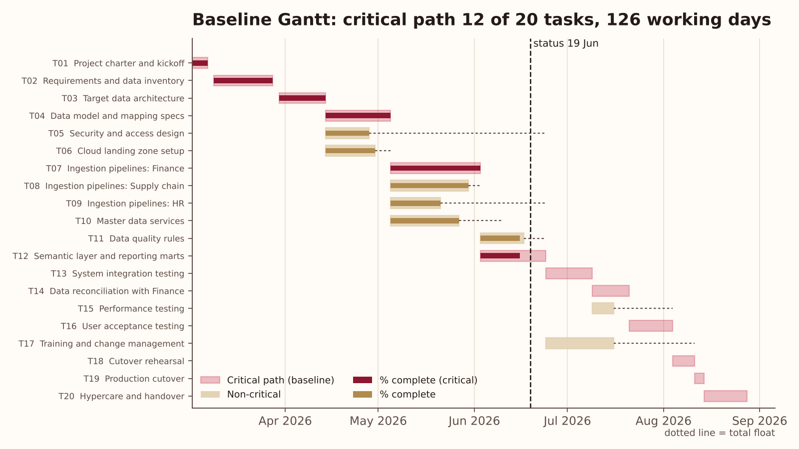

# EVM + RAID Kit

**Turn a WBS plan, weekly timesheets and a RAID log into an executive-ready status report: earned value, earned schedule, critical path and risk analytics in one tested Python pipeline.**

[](https://github.com/laurenbmcguire/evm-raid-kit/actions/workflows/ci.yml)




> Portfolio project by Lauren McGuire. All inputs are synthetic and produced by a seeded generator in this repo; every number below comes from running the code on that data.

## Why it matters

- **Status reports drift from the numbers.** RAG colours are often set by feel. Here every colour comes from explicit rules on CPI, SPI(t), forecast slip and RAID scores, so the report can be audited and reproduced.
- **Cost-based SPI hides late projects.** SPI = EV/PV drifts back to 1.0 as a late project nears completion. Earned schedule (SPI(t)) keeps measuring time and gives a forecast finish date a sponsor can act on.
- **Risk logs rot.** Overdue mitigations and aging issues are where surprises come from. The kit scores, ages and assigns them, and turns the worst into named decisions for the steering committee.

## What it does

- **EVM engine:** PV from a linear spread of each task's budget over its planned working days; EV = % complete x budget; AC as a weekly time series from timesheets; SV, CV, SPI, CPI.
- **Forecasts:** EAC by three methods (BAC/CPI, AC + (BAC - EV), AC + (BAC - EV)/(CPI x SPI)), ETC, VAC and TCPI (to BAC and to EAC).
- **Earned schedule:** ES, SPI(t), SV(t), IEAC(t) and a forecast finish date on the working calendar.
- **Critical path:** CPM forward and backward pass on a Monday-Friday calendar with holidays; total float, free float and the critical path; flags critical tasks that are behind plan.
- **RAID analytics:** probability x impact scores, 5x5 heatmap, overdue and aging items, open issues by owner; items are evaluated as of the status date using raised and closed dates.
- **RAG rules:** scope, schedule, cost and risk, with thresholds in `examples/project.yml`.
- **Outputs:** `reports/status_report.md` (one-pager: headline, RAG, key metrics, top risks, decisions needed, watch list), `reports/summary.json` and five charts in `docs/img/`.
- **Configurable status date:** `--status-date` replays any earlier week from timesheet history (AC and progress snapshots).
- **AI Project Manager:** manages this repository as a project and publishes `project/STATUS.md` weekly.

## Architecture



## Results on the sample data

Synthetic "ERP data platform rollout": 20 WBS tasks, BAC $1,205,000, baseline 2 Mar to 27 Aug 2026 (126 working days), status date 19 Jun 2026. The scenario is generated to show a mild cost overrun and a slight schedule slip.

| Metric | Value | Metric | Value |
|---|---:|---|---:|
| PV | $850,200 | CPI | 0.93 |
| EV | $819,400 | SPI | 0.96 |
| AC | $878,625 | SPI(t) (ES 74.0 / AT 78 days) | 0.95 |
| CV | -$59,225 | SV | -$30,800 |
| EAC = BAC/CPI | $1,292,096 | VAC | -$87,096 (-7.2%) |
| EAC = AC + (BAC - EV) | $1,264,225 | TCPI to BAC | 1.18 |
| EAC = AC + (BAC - EV)/(CPI x SPI) | $1,307,637 | Forecast finish (ES) | 8 Sep 2026 (+7 working days) |
| Critical path | 12 of 20 tasks | Critical tasks behind plan | T12 Semantic layer |
| Open RAID items | 18 (5 overdue) | Open risks scored >= 15 | 2 (max 16) |
| **RAG** | Scope **Green**, Schedule **Amber**, Cost **Amber**, Risk **Amber** | **Overall** | **Amber** |

Note the gap between SPI 0.96 and SPI(t) 0.95: the time-based index is the more conservative and drives the forecast finish. The full one-pager is in [reports/status_report.md](reports/status_report.md).

| CPI, SPI and SPI(t) by week | Open risk heatmap |
|---|---|
|  |  |
| **RAID aging** | **Baseline Gantt with critical path** |
|  |  |

## AI Project Manager

`python -m evmkit pm` runs an AI PM agent that manages this repository as a project. It reads `project/ROADMAP.yml` (milestones and backlog), `project/RISKS.yml` and the pipeline's `reports/summary.json`, then writes [project/STATUS.md](project/STATUS.md) and `project/status.json`.

The deterministic engine always runs and is covered by tests:

- **Health RAG with a one-line reason.** Red if two or more milestones are overdue, an overdue milestone coincides with an open P0, or a risk scores 20+. Amber on any overdue milestone, open P0 or risk scoring 15+. Otherwise Green.
- **Milestone table** with % done (share of linked backlog items done).
- **Risk register** sorted by score (probability x impact) with a High / Medium / Low heat label.
- **Next 3 actions:** unblocked `todo` items ranked by priority, then by dependencies satisfied.
- **What the data says:** 3-5 bullets taken from `summary.json`, so the PM reports what the analysis actually found.
- **Decision / change log** entry for the run.

Excerpt from the committed [project/STATUS.md](project/STATUS.md):

```text
Date: 2026-11-02 | Health: AMBER
> Amber: 1 open P0 item(s) (B10); 2 risk(s) scored >= 15 (R1, R3).

| # | ID  | Action                                         | Priority | Owner  |
| 1 | B10 | Baseline change log tied to change-request ids | P0       | Lauren |
| 2 | B15 | Tidy long-format export for BI tools           | P1       | AI PM  |
| 3 | B13 | Excel (.xlsx) reader with column mapping       | P1       | AI PM  |

What the data says
- EVM at 2026-06-19: CPI 0.93, SPI 0.96; EAC (BAC/CPI) $1.29M vs BAC $1.21M (VAC -7.2%).
- Earned schedule: SPI(t) 0.95 forecasts finish 2026-09-08, +7 working days vs the 2026-08-27 baseline.
```

**LLM mode (optional).** If `ANTHROPIC_API_KEY` is set, the PM sends the computed facts JSON to the Anthropic Messages API (standard-library `urllib`, model from `AI_PM_MODEL`, default `claude-sonnet-4-5`) and asks for a 90-120 word executive summary grounded only in those facts. With no key, or on any error, it uses a deterministic template, so the run never fails because of the LLM. Tests mock the HTTP call and never touch the network.

**Automation.** `.github/workflows/ai-pm.yml` runs every Monday at 13:17 UTC (and on demand): it runs the pipeline and the PM, appends STATUS.md to the job summary and commits changed status, charts and reports as `github-actions[bot]`. Add `ANTHROPIC_API_KEY` as a repository secret to enable the LLM summary.

## Quickstart

```bash
git clone https://github.com/laurenbmcguire/evm-raid-kit.git
cd evm-raid-kit
pip install -e .
python -m evmkit run                           # data -> analysis -> charts + report
python -m evmkit run --status-date 2026-05-15  # replay an earlier status week
python -m evmkit pm                            # AI project manager -> project/STATUS.md
pip install pytest && pytest -q
```

The full run takes about 2 seconds offline. To use your own project, replace the three CSVs in `examples/` (same columns) and edit `examples/project.yml`.

## Project structure

```text
evm-raid-kit/
├── src/evmkit/
│   ├── cli.py          # python -m evmkit run | pm | generate
│   ├── data.py         # seeded generator + validated CSV loaders
│   ├── workcal.py      # working-day calendar (weekends, holidays)
│   ├── evm.py          # PV spread, EV, AC, SV/CV/SPI/CPI, EAC x3, ETC, VAC, TCPI
│   ├── schedule.py     # earned schedule: ES, SPI(t), forecast finish
│   ├── cpm.py          # critical path, total and free float
│   ├── raid.py         # scoring, heatmap, aging, overdue, owners
│   ├── rag.py          # RAG rules
│   ├── report.py       # headline, decisions, Markdown one-pager
│   ├── charts.py       # S-curves, index trend, heatmap, aging, Gantt
│   ├── style.py        # single brand style helper for matplotlib
│   ├── pipeline.py     # end-to-end run
│   └── ai_pm.py        # AI project manager
├── tests/              # 20 pytest tests (formulas vs hand-computed values, CPM, RAID, RAG, pipeline, AI PM)
├── examples/           # plan.csv, timesheets.csv, raid.csv, project.yml (synthetic)
├── reports/            # status_report.md, summary.json
├── docs/img/           # charts produced by the pipeline
├── project/            # ROADMAP.yml, RISKS.yml, STATUS.md, status.json
└── .github/workflows/  # ci.yml, ai-pm.yml
```

## Methodology

**Planned value.** Each task's budget is spread linearly over its planned working days (Mon-Fri minus holidays). With `s` the task's start index, `D` its working-day duration and `n` the working days completed by a date:
`PV_task(n) = budget x clip((n - s) / D, 0, 1)`.

**Earned value and actual cost.** `EV = % complete x budget`. At the plan's data date, % complete comes from `plan.csv`; for earlier status dates it comes from the latest progress snapshot in `timesheets.csv`. `AC` is the cumulative timesheet cost for weeks ending on or before the status date. The report reconciles `plan.csv` AC against the timesheets.

**Indices and forecasts.**

| Measure | Formula |
|---|---|
| SV, CV | EV - PV, EV - AC |
| SPI, CPI | EV / PV, EV / AC |
| EAC (CPI) | BAC / CPI |
| EAC (atypical) | AC + (BAC - EV) |
| EAC (composite) | AC + (BAC - EV) / (CPI x SPI) |
| ETC, VAC | EAC - AC, BAC - EAC (CPI method is the primary EAC) |
| TCPI | (BAC - EV) / (BAC - AC) to BAC; (BAC - EV) / (EAC - AC) to EAC |

**Earned schedule.** With `PV[n]` the cumulative PV after `n` working days and `C` the largest `n` with `PV[n] <= EV`:
`ES = C + (EV - PV[C]) / (PV[C+1] - PV[C])`, `SPI(t) = ES / AT`, `SV(t) = ES - AT`, `IEAC(t) = PD / SPI(t)`.
The forecast finish is the working day at `ceil(IEAC(t))` from the project start.

**CPM.** Finish-to-start dependencies, half-open working-day offsets: `ES = max(EF of predecessors)`, `EF = ES + duration`; backward pass `LF = min(LS of successors)`, `LS = LF - duration`. Total float `LS - ES`, free float `min(ES of successors) - EF`; critical tasks have zero total float.

**RAID.** `score = probability x impact` (1-5 each): High >= 15, Medium 8-14, Low < 8. An item is open at the status date if raised on or before it and not closed by then; overdue if open and past due. Aging buckets: 0-14, 15-30, 31-60, 61+ days since raised.

**RAG rules (defaults in `project.yml`).**

| Dimension | Green | Red | Otherwise |
|---|---|---|---|
| Schedule | SPI(t) >= 0.95 and slip <= 5 wd | SPI(t) < 0.90 or slip > 20 wd | Amber |
| Cost | CPI >= 0.95 and VAC >= -5% | CPI < 0.90 or VAC < -10% | Amber |
| Scope | <= 1 open Scope item scored >= 12 | >= 3 such items | Amber |
| Risk | no open risk >= 15 and < 3 overdue items | any risk >= 20 or >= 3 risks >= 15 | Amber |

Overall RAG is the worst of the four. "Decisions needed" are generated by rules: funding when VAC < 0, schedule when the forecast slips, each risk scoring 15+, and overdue RAID items.

**Limits.** Linear PV spread suits effort-driven tasks; front- or back-loaded work would need custom curves. EV is only as good as the % complete reported. CPM uses finish-to-start links without lags.

## Data

All data in this repository is **synthetic**. `evmkit.data.generate` (seed 12) builds a generic 20-task ERP data platform rollout, simulates task durations and cost rates with a seeded random generator, and writes weekly timesheets and a 23-item RAID log. Owners are role names, not people. It does not describe any real organisation, project, client or result. The generator runs automatically if the CSVs are missing.

## Roadmap

From [project/ROADMAP.yml](project/ROADMAP.yml):

| ID | Milestone | Due | Status |
|---|---|---|---|
| M1 | EVM engine | 2026-10-16 | done |
| M2 | Earned schedule and CPM | 2026-10-23 | done |
| M3 | RAID analytics and RAG rules | 2026-10-27 | done |
| M4 | Report generator and charts | 2026-10-30 | done |
| M5 | AI PM and CI workflows | 2026-11-02 | done |
| M6 | Data quality guards (% complete validation, timesheet lag check, baseline change log) | 2026-11-20 | in progress |
| M7 | Excel and Smartsheet import | 2026-12-18 | planned |
| M8 | Power BI template | 2027-01-29 | planned |

Tracked project risks include inaccurate % complete, timesheet lag and baseline changes without change control; see [project/RISKS.yml](project/RISKS.yml).

## Author

**Lauren McGuire**, AI & Cloud Architect
[laurenmcguireresume.com](https://laurenmcguireresume.com) | [LinkedIn](https://www.linkedin.com/in/laurenbmcguire)
